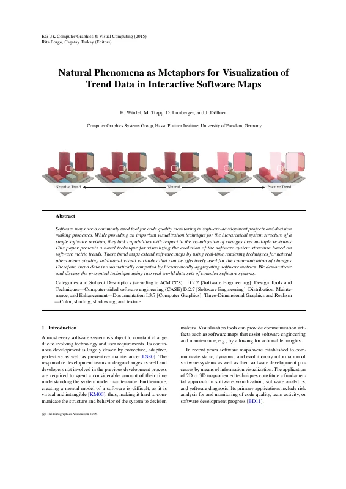
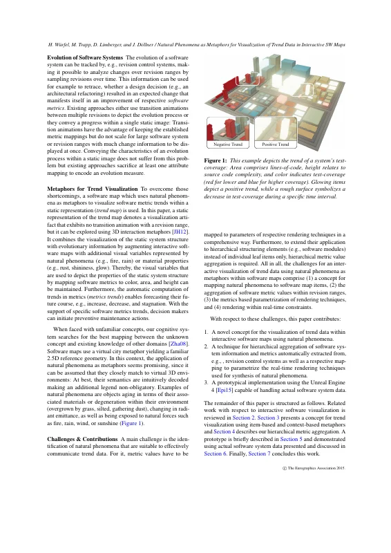
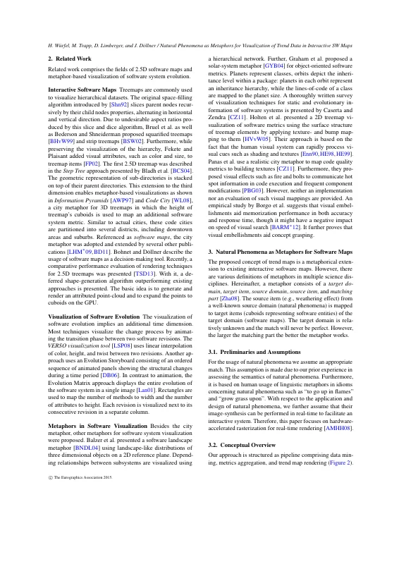
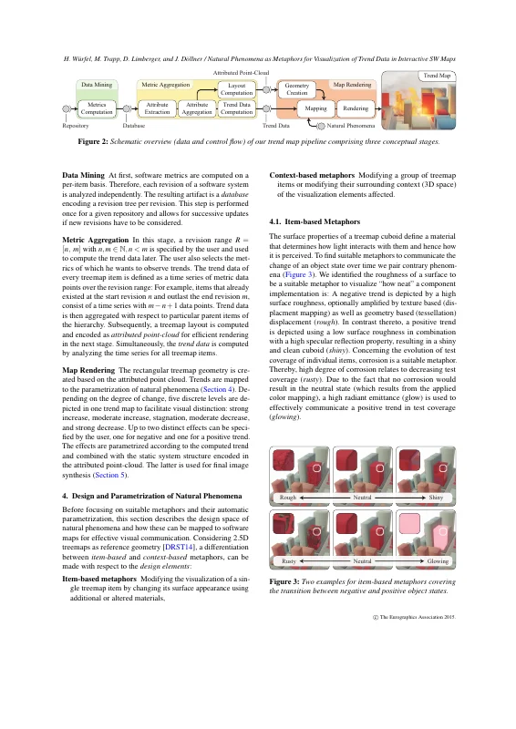
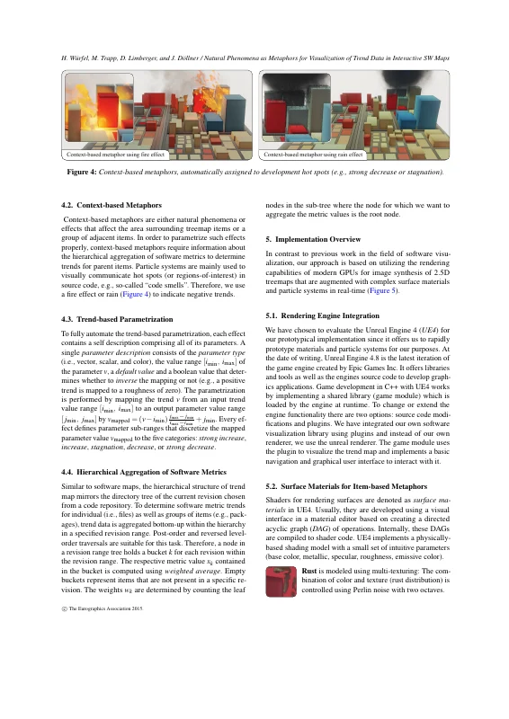
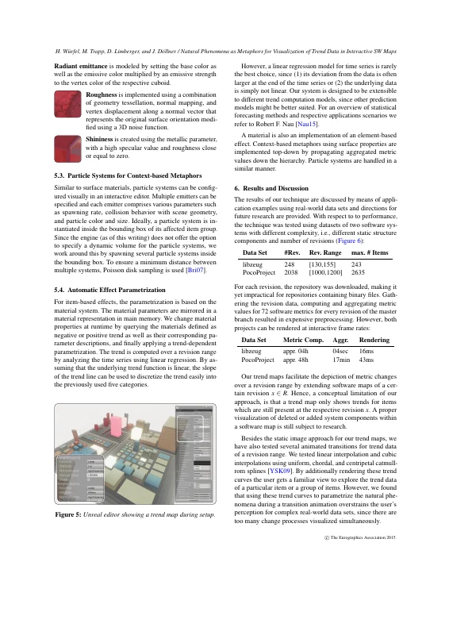
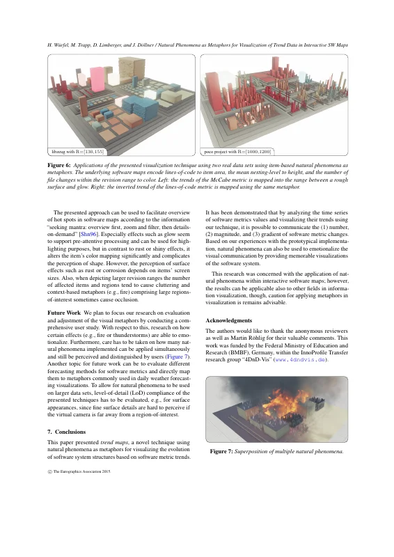
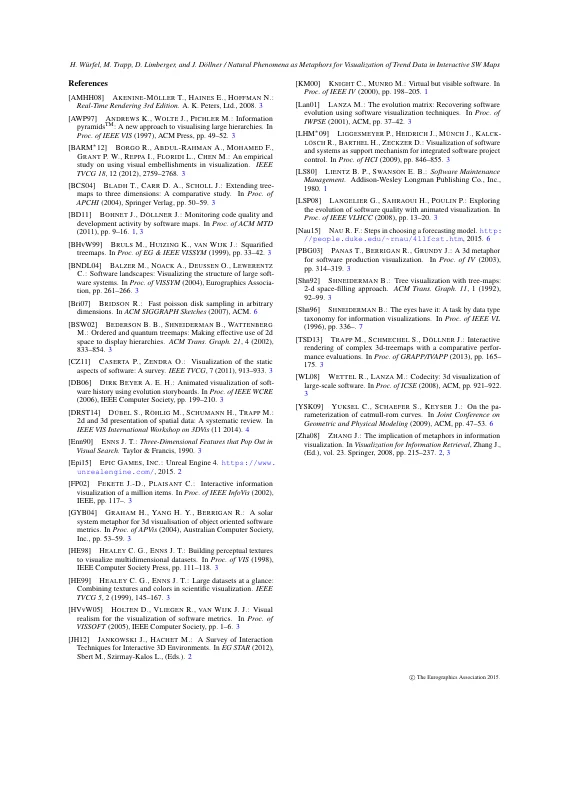

# Natural Phenomena as Metaphors for Visualization of Trend Data in Interactive Software Maps

Hannes Würfel, [Matthias Trapp](https://orcid.org/0000-0003-3861-5759), [Daniel Limberger](https://orcid.org/0000-0002-9111-4809), and [Jürgen Döllner](https://orcid.org/0000-0002-8981-8583)

*Computer Graphics and Visual Computing (CGVC '15)*, September 16–17, 2015, London, United Kingdom. Eurographics Association, pp. 69–76.

[](https://doi.org/10.2312/cgvc.20151246) [](https://doi.org/10.5281/zenodo.24221663)

> Software maps are a commonly used tool for code quality monitoring in software-development projects and decision making processes.
> While providing an important visualization technique for the hierarchical system structure of a single software revision, they lack capabilities with respect to the visualization of changes over multiple revisions.
> This paper presents a novel technique for visualizing the evolution of the software system structure based on software metric trends.
> These trend maps extend software maps by using real-time rendering techniques for natural phenomena yielding additional visual variables that can be effectively used for the communication of changes.
> Therefore, trend data is automatically computed by hierarchically aggregating software metrics.
> We demonstrate and discuss the presented technique using two real world data sets of complex software systems.

<p><a href="wuerfel2015-natural-phenomena-as-submitted.pdf"></a> <a href="wuerfel2015-natural-phenomena-as-submitted.pdf"></a> <a href="wuerfel2015-natural-phenomena-as-submitted.pdf"></a> <a href="wuerfel2015-natural-phenomena-as-submitted.pdf"></a></p>
<details><summary>Remaining 4 pages</summary><p><a href="wuerfel2015-natural-phenomena-as-submitted.pdf"></a> <a href="wuerfel2015-natural-phenomena-as-submitted.pdf"></a> <a href="wuerfel2015-natural-phenomena-as-submitted.pdf"></a> <a href="wuerfel2015-natural-phenomena-as-submitted.pdf"></a></p></details>

## Contents

- [`src/`](src/) – LaTeX sources of the camera-ready version (Eurographics `egpubl` class, CGVC 2015 style)
- [`wuerfel2015-natural-phenomena-as-submitted.pdf`](wuerfel2015-natural-phenomena-as-submitted.pdf) – camera-ready PDF as submitted (2015-08-11)
- [`build.sh`](build.sh) – reproducible build with TeX Live 2013, podman or docker
- [`preview/`](preview/) – page previews for this README

## Build

```bash
./build.sh   # → build/natural-metaphors-cgvc2015-final.pdf
```

The paper was compiled with MiKTeX 2.9 in 2015 (pdfTeX 1.40.14).
The TeX Live 2013 container (pdfTeX 1.40.14) reproduces `wuerfel2015-natural-phenomena-as-submitted.pdf` with identical text and layout; only the running heads differ by less than 0.06 pt in word spacing (a few pixels at 60 dpi).

The final export of the pipeline figure (`src/figures/pipeline.pdf`, Adobe Illustrator, 2015-08-10 23:27) was not preserved with the sources; the surviving earlier export differs in one label ("Point Cloud" instead of "Point-Cloud").
`src/figures/pipeline.pdf` was therefore restored from the embedded figure of the submitted PDF (vector content and resources copied unchanged).

## Versions

- [`v1.0-camera-ready`](https://github.com/dl-archive/article.2015-cgvc-natural-metaphors/tree/v1.0-camera-ready) – sources as submitted to Eurographics (2015)

## Citation

```bibtex
@InProceedings{wuerfel2015-natural-phenomena,
  author    = {W{\"u}rfel, Hannes and Trapp, Matthias and Limberger, Daniel and D{\"o}llner, J{\"u}rgen},
  title     = {Natural Phenomena as Metaphors for Visualization of Trend Data in Interactive Software Maps},
  booktitle = {Computer Graphics and Visual Computing (CGVC)},
  year      = {2015},
  series    = {CGVC~'15},
  publisher = {Eurographics Association},
  pages     = {69--76},
  doi       = {10.2312/cgvc.20151246},
  isbn      = {978-3-905674-94-1},
}
```
